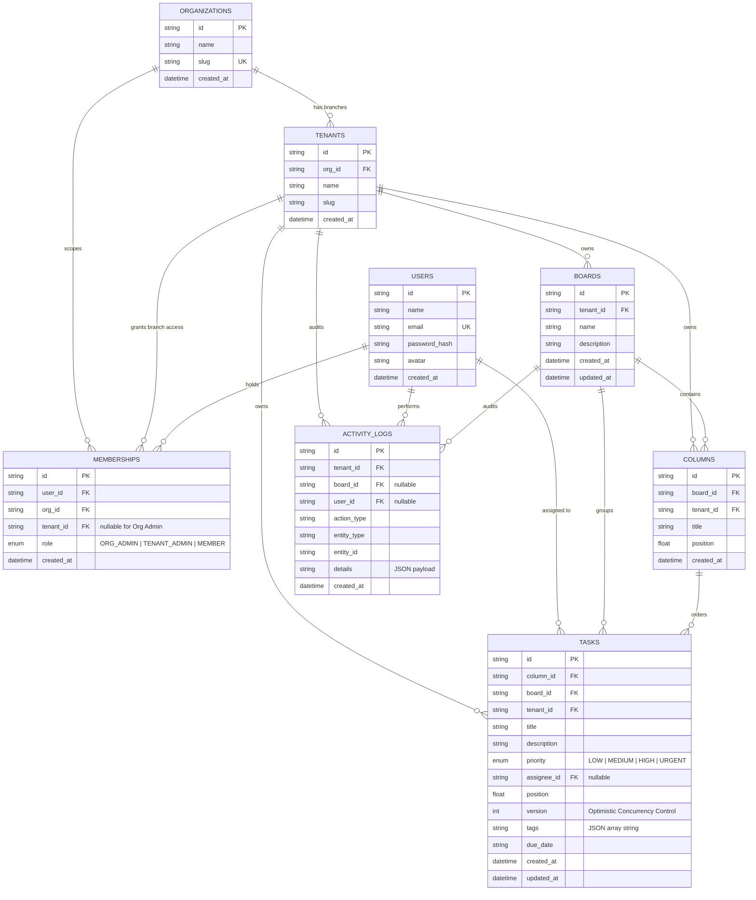

# WorkSphere Database Architecture & Entity Relationship Diagram (ERD)

WorkSphere uses **Neon Cloud PostgreSQL (AWS Singapore)** with **Prisma ORM**. The schema consists of 8 normalized relational tables enforcing referential integrity, cascading deletes, unique constraints, and composite indexes for tenant-scoped query performance.

---

## 1. Mermaid Entity-Relationship Diagram

---

## 2. Table Specifications

### 1. `organizations`
- `id` (VARCHAR/TEXT, Primary Key)
- `name` (VARCHAR/TEXT, Not Null)
- `slug` (VARCHAR/TEXT, Unique, Not Null)
- `created_at` (TIMESTAMP WITH TIME ZONE, Default now())

### 2. `tenants`
- `id` (VARCHAR/TEXT, Primary Key)
- `org_id` (VARCHAR/TEXT, Foreign Key -> `organizations.id` ON DELETE CASCADE)
- `name` (VARCHAR/TEXT, Not Null)
- `slug` (VARCHAR/TEXT, Not Null)
- `created_at` (TIMESTAMP WITH TIME ZONE, Default now())
- **Unique Constraint**: `(org_id, slug)`
- **Index**: `(org_id)`

### 3. `users`
- `id` (VARCHAR/TEXT, Primary Key)
- `name` (VARCHAR/TEXT, Not Null)
- `email` (VARCHAR/TEXT, Unique, Not Null)
- `password_hash` (VARCHAR/TEXT, Not Null, Bcrypt hashed)
- `avatar` (VARCHAR/TEXT, Nullable)
- `created_at` (TIMESTAMP WITH TIME ZONE, Default now())

### 4. `memberships`
- `id` (VARCHAR/TEXT, Primary Key)
- `user_id` (VARCHAR/TEXT, Foreign Key -> `users.id` ON DELETE CASCADE)
- `org_id` (VARCHAR/TEXT, Foreign Key -> `organizations.id` ON DELETE CASCADE)
- `tenant_id` (VARCHAR/TEXT, Nullable, Foreign Key -> `tenants.id` ON DELETE CASCADE)
- `role` (ENUM: `ORG_ADMIN`, `TENANT_ADMIN`, `MEMBER`)
- `created_at` (TIMESTAMP WITH TIME ZONE, Default now())
- **Unique Constraint**: `(user_id, org_id, tenant_id)`
- **Indexes**: `(user_id)`, `(org_id)`, `(tenant_id)`

### 5. `boards`
- `id` (VARCHAR/TEXT, Primary Key)
- `tenant_id` (VARCHAR/TEXT, Foreign Key -> `tenants.id` ON DELETE CASCADE)
- `name` (VARCHAR/TEXT, Not Null)
- `description` (TEXT, Nullable)
- `created_at` (TIMESTAMP WITH TIME ZONE, Default now())
- `updated_at` (TIMESTAMP WITH TIME ZONE, Default now())
- **Index**: `(tenant_id)`

### 6. `columns`
- `id` (VARCHAR/TEXT, Primary Key)
- `board_id` (VARCHAR/TEXT, Foreign Key -> `boards.id` ON DELETE CASCADE)
- `tenant_id` (VARCHAR/TEXT, Foreign Key -> `tenants.id` ON DELETE CASCADE)
- `title` (VARCHAR/TEXT, Not Null)
- `position` (DOUBLE PRECISION, Not Null)
- `created_at` (TIMESTAMP WITH TIME ZONE, Default now())
- **Indexes**: `(board_id, position)`, `(tenant_id)`

### 7. `tasks`
- `id` (VARCHAR/TEXT, Primary Key)
- `column_id` (VARCHAR/TEXT, Foreign Key -> `columns.id` ON DELETE CASCADE)
- `board_id` (VARCHAR/TEXT, Foreign Key -> `boards.id` ON DELETE CASCADE)
- `tenant_id` (VARCHAR/TEXT, Foreign Key -> `tenants.id` ON DELETE CASCADE)
- `title` (VARCHAR/TEXT, Not Null)
- `description` (TEXT, Nullable)
- `priority` (ENUM: `LOW`, `MEDIUM`, `HIGH`, `URGENT`)
- `assignee_id` (VARCHAR/TEXT, Nullable, Foreign Key -> `users.id` ON DELETE SET NULL)
- `position` (DOUBLE PRECISION, Not Null)
- `version` (INTEGER, Not Null, Default 1) — Optimistic Concurrency Control
- `tags` (TEXT, JSON array string)
- `due_date` (VARCHAR/TEXT, Nullable)
- `created_at` (TIMESTAMP WITH TIME ZONE, Default now())
- `updated_at` (TIMESTAMP WITH TIME ZONE, Default now())
- **Indexes**: `(column_id, position)`, `(board_id)`, `(tenant_id)`, `(assignee_id)`

### 8. `activity_logs`
- `id` (VARCHAR/TEXT, Primary Key)
- `tenant_id` (VARCHAR/TEXT, Foreign Key -> `tenants.id` ON DELETE CASCADE)
- `board_id` (VARCHAR/TEXT, Nullable, Foreign Key -> `boards.id` ON DELETE CASCADE)
- `user_id` (VARCHAR/TEXT, Nullable, Foreign Key -> `users.id` ON DELETE SET NULL)
- `action_type` (VARCHAR/TEXT, Not Null)
- `entity_type` (VARCHAR/TEXT, Not Null)
- `entity_id` (VARCHAR/TEXT, Not Null)
- `details` (TEXT, JSON serialized string)
- `created_at` (TIMESTAMP WITH TIME ZONE, Default now())
- **Indexes**: `(tenant_id, created_at DESC)`, `(board_id)`, `(user_id)`
